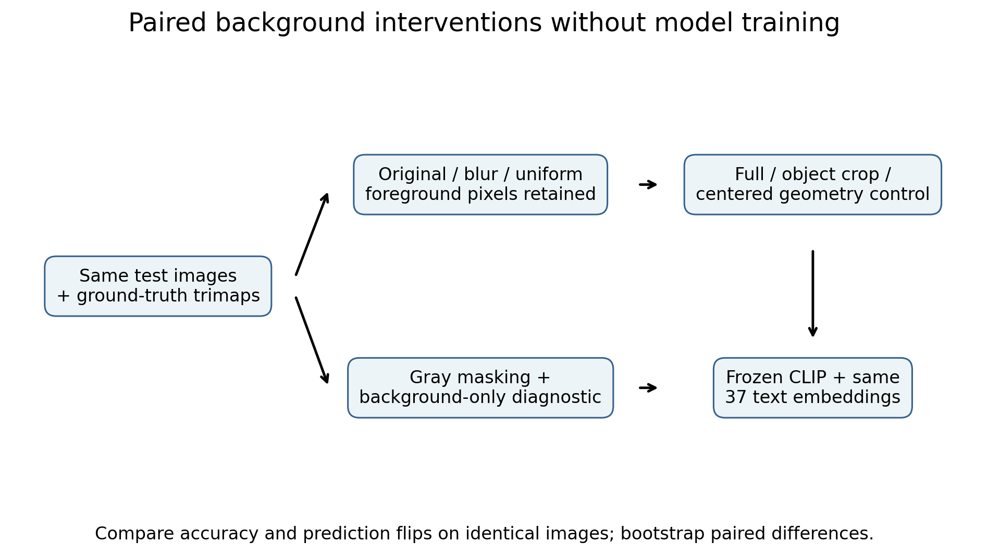
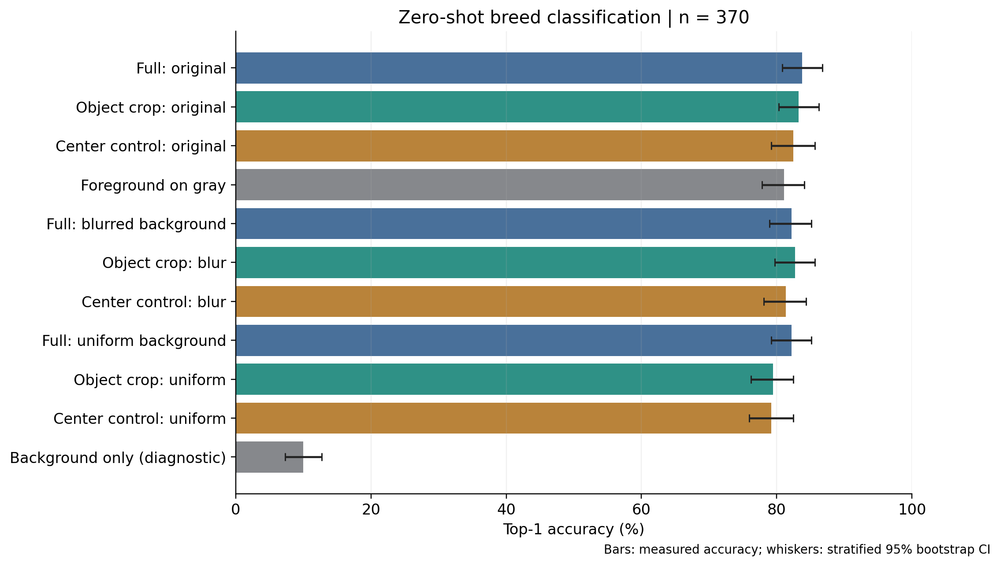
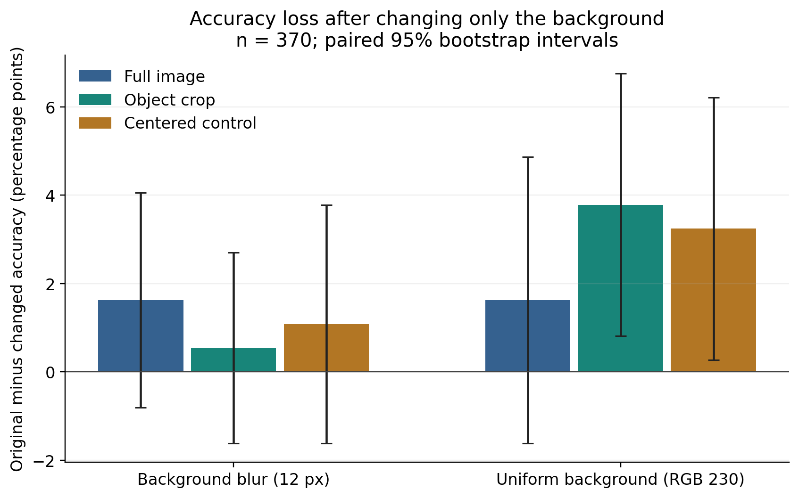
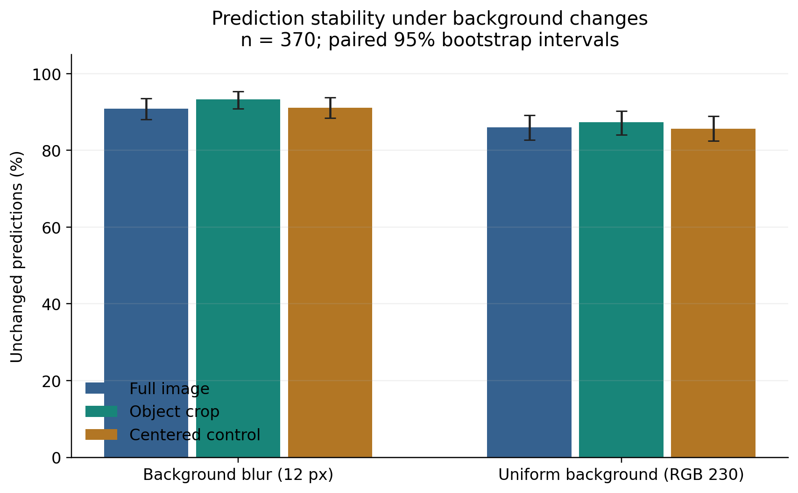

# Can Object-Centric Processing Reduce Background Bias in Vision Models?

A reproducible, inference-only AIST1000 seminar project using OpenAI CLIP ViT-B/32 and Oxford-IIIT Pet. The experiment asks whether focusing on an animal makes breed predictions more stable when its background changes. It does **not** assume cropping improves accuracy.

**Measured finding:** on 370 test images, cropping slightly reduced observed prediction flips, but both paired confidence intervals included zero. Original-image accuracy was 83.78% for full images and 83.24% for object crops. These results do not establish a reliable robustness benefit.

## Motivation and core idea

A breed classifier should ideally recognize the animal across different settings. CLIP compares an image embedding with text embeddings of candidate descriptions, allowing classification without task-specific training ([Radford et al., 2021](https://proceedings.mlr.press/v139/radford21a.html)). Here, all conditions share one frozen model, one ordered list of 37 breeds, and the exact prompt `a photo of a {breed}`.

Ground-truth segmentation provides an object crop or a foreground mask. Controlled background interventions then test prediction stability within each processing method. An accuracy gain from cropping alone would not isolate background dependence: cropping also changes scale, composition, and which pixels CLIP's center crop retains.



## Dataset and conditions

[Oxford-IIIT Pet](https://www.robots.ox.ac.uk/~vgg/data/pets/) contains 37 cat and dog breeds with trimap annotations. Loading uses `torchvision.datasets.OxfordIIITPet(split="test", target_types=["category", "segmentation"])`. No training split is used. The default subset has **370 images, exactly 10 per breed**, sampled deterministically with seed 42. Every condition uses those same images and labels. Full split size: 3,669 images.

Raw trimap values are **1 foreground, 2 background, 3 uncertain boundary**. The default keeps 1 and 3. A hard binary composite preserves their RGB pixels exactly before CLIP preprocessing. No feathering or erosion is applied. Local visual inspection confirmed the intended mapping, but also visible halos and retained nearby background; this is a limitation. `--boundary exclude` supports a future sensitivity analysis and was not used for the published results.

| Condition | Operation before the shared CLIP preprocessing |
| --- | --- |
| A: Full original | Unmodified RGB image |
| B: Object crop | Bounding box of retained trimap pixels, padded by 10% of box width/height **on each side**, rounded up and clipped to image boundaries |
| C: Foreground on gray | Replace label-2 background with RGB (128,128,128) |
| D1: Background blur | Gaussian blur, radius 12 source-image pixels, composited only into label-2 background |
| D2: Uniform background | Replace label-2 background with RGB (230,230,230), distinct from C |
| E: Background only | Replace the retained foreground with RGB (128,128,128); diagnostic only |
| Centered crop control | Same width and height as the padded animal box, positioned at the image center |

For **full image, object crop, and centered crop**, evaluate original, blurred, and uniform-background versions: 9 paired conditions, plus C and E, giving **11 conditions and 4,070 image inferences**. Background changes occur before cropping; each image's crop coordinates are identical across interventions. Blur can spread animal colors into neighboring background pixels even though foreground RGB values remain unchanged. Foreground preservation is asserted by synthetic unit tests. Normal resize/interpolation may mix edge colors afterward.

The centered control matches crop dimensions and subsequent resizing, but uses annotation-derived dimensions and can truncate the animal. It is an imperfect geometry control, not a complete causal separation of scale and context.

## Installation

Tested on **Python 3.12.9, Windows 11, NVIDIA RTX 5070 Ti Laptop GPU**, PyTorch 2.7.1+cu128, torchvision 0.22.1+cu128, OpenCLIP 3.2.0. Python 3.11 is also compatible with these direct dependency pins but was not tested here.

Create and activate an isolated environment from the repository directory:

```powershell
python -m venv .venv
.\.venv\Scripts\Activate.ps1
```

On macOS/Linux, activate with `source .venv/bin/activate`. If PowerShell activation is disabled, use `.\.venv\Scripts\python.exe` in place of `python` below; no policy change is needed.

For the tested NVIDIA CUDA 12.8 installation:

```text
python -m pip install torch==2.7.1 torchvision==0.22.1 --index-url https://download.pytorch.org/whl/cu128
python -m pip install -r requirements.txt
```

For CPU-only Windows/Linux, install those two packages from `https://download.pytorch.org/whl/cpu` first. On macOS, use the default PyPI index. See [official PyTorch installation commands](https://pytorch.org/get-started/previous-versions/). CPU inference works with `--device cpu`; automatic selection uses CUDA if available and otherwise CPU. An explicitly requested unavailable CUDA device fails clearly.

`requirements.txt` pins direct dependencies; `requirements-lock-windows-cu128.txt` records the complete executed Windows environment. To reproduce that environment exactly, install it with `python -m pip install -r requirements-lock-windows-cu128.txt --extra-index-url https://download.pytorch.org/whl/cu128`. The complete lock is platform-specific.

## Run and reproduce

Unit tests require neither the dataset nor pretrained weights:

```text
python -m pytest -q
python -m pip check
```

Smoke test (5 images, 55 image inferences; verifies execution, not scientific evidence):

```text
python scripts/run_experiment.py --download --samples 5 --bootstrap 200 --output-dir results/smoke
```

Main experiment, exactly as executed:

```text
python scripts/run_experiment.py --download --samples 370 --seed 42 --batch-size 32 --device auto --output-dir results/main
```

The repository includes `results/main`, so after cloning choose an empty destination, for example:

```text
python scripts/run_experiment.py --download --samples 370 --seed 42 --batch-size 32 --device auto --output-dir local_outputs/reproduction
```

Existing nonempty output directories are refused to preserve previous results. Choose a new directory for every run. `--download` downloads/extracts the dataset only if missing. The official model checkpoint and reusable text embeddings are cached under `.cache`; no repeated weight download is needed. Network access and several GB of disk space are required for the initial setup. The complete dataset download is about 774 MiB compressed; it is not bundled here.

All defaults are in [configs/default.yaml](configs/default.yaml). CLI overrides include `--samples`, `--seed`, `--batch-size`, `--device`, `--output-dir`, `--data-dir`, `--cache-dir`, `--local-dir`, `--bootstrap`, and `--boundary`. Paths resolve from the repository root. Sampling spreads images across breeds in seeded round-robin order; counts below 37 cover only some breeds, while retaining all 37 candidate labels.

Regenerate charts from measured CSVs without loading CLIP:

```text
python scripts/plot_results.py --results results/main
```

Audit pairing, labels and saved CSV/JSON against deterministically recomputed bootstrap tables:

```text
python scripts/verify_results.py --results results/main
```

A second complete GPU run produced byte-identical predictions, numerical results and sample manifest. A separate two-image CPU run also completed successfully. Deterministic flags do not guarantee bit-identical floating-point results on other hardware or library versions.

The model uses `eval()`, frozen parameters, and `torch.inference_mode()`. Inference uses float32, normalized image/text embeddings and cosine-similarity argmax. CUDA determinism is enabled and TF32 disabled. The canonical OpenAI TorchScript checkpoint is SHA256 verified by OpenCLIP; its loading call explicitly supports PyTorch's changed `weights_only` default. No model is trained or fine-tuned.

## Evaluation

- **Top-1 accuracy:** fraction of images whose predicted breed matches the label.
- **Accuracy drop:** original accuracy minus background-modified accuracy for the *same method*. Positive values mean degradation; negative values mean improvement.
- **Consistency:** fraction whose predicted breed stays unchanged after intervention, including unchanged incorrect answers.
- **Flip rate:** one minus consistency. A changed prediction can improve or harm accuracy.
- **Paired method comparison:** crop minus full-image flip rate, and the difference between their accuracy changes, calculated per image before averaging.

Confidence intervals are 95% percentile intervals from **5,000 class-stratified paired bootstrap resamples, seed 42**: images are sampled with replacement within each breed, retaining the class counts. Bounds describe image-sampling uncertainty conditional on these classes, this model and the chosen interventions. They do not measure uncertainty across datasets, masks, models, or prompt choices. With only one image per sampled breed, smoke-test bootstrap intervals degenerate and have no inferential value. Comparisons are exploratory and not corrected for multiple testing. Differences between percentages are reported in **percentage points (pp)**, not relative percent changes. Cosine similarities in `predictions.csv` are ranking scores, not calibrated confidence probabilities; no softmax confidence claims are made.

## Measured results

Executed on **28 October 2026**. Each accuracy uses n=370. Numbers below come from [accuracy.csv](results/main/accuracy.csv) and [paired_metrics.csv](results/main/paired_metrics.csv).

| Processing | Original accuracy | Background blur accuracy | Uniform background accuracy | Blur consistency | Uniform consistency |
| --- | ---: | ---: | ---: | ---: | ---: |
| Full image | 83.78% | 82.16% | 82.16% | 90.81% | 85.95% |
| Object crop | 83.24% | 82.70% | 79.46% | 93.24% | 87.30% |
| Centered control | 82.43% | 81.35% | 79.19% | 91.08% | 85.68% |

Foreground on gray: **81.08%** (95% CI 77.84–84.05%). Background-only diagnostic: **10.00%** (7.30–12.70%), compared with a uniform random-choice reference of 1/37 = 2.70%. The diagnostic is not proof of background-only reasoning: the gray silhouette, residual animal pixels, and mask artifacts can retain breed information.

| Key paired comparison | Estimate (pp) | 95% bootstrap CI (pp) |
| --- | ---: | ---: |
| Original crop accuracy minus full accuracy | −0.54 | [−2.97, +1.89] |
| Blur flip rate: crop minus full | −2.43 | [−5.41, +0.54] |
| Uniform flip rate: crop minus full | −1.35 | [−4.32, +1.89] |
| Blur accuracy drop: full | +1.62 | [−0.81, +4.05] |
| Blur accuracy drop: crop | +0.54 | [−1.62, +2.70] |
| Uniform accuracy drop: full | +1.62 | [−1.62, +4.86] |
| Uniform accuracy drop: crop | +3.78 | [+0.81, +6.76] |





**Interpretation.** Background changes altered full-image predictions on 9.19% of images for blur and 14.05% for uniform replacement. Cropping reduced these observed rates to 6.76% and 12.70%, but the paired intervals for the reductions both include zero. Cropping also slightly reduced original accuracy and produced a larger observed accuracy drop under uniform replacement. The difference between the uniform accuracy changes, crop minus full, was −2.16 pp (95% CI −5.14 to +0.81), so a stronger comparative claim is unwarranted. Accuracy and stability must be assessed separately. This experiment demonstrates background sensitivity under the specified interventions, while leaving the robustness benefit of cropping unresolved.

## Reproducibility files and academic materials

- `src/`: dataset loading, preprocessing, frozen inference, paired metrics, and plotting.
- `tests/`: 28 executed tests covering masks, pixel preservation, crop bounds, tiny/empty masks, missing files, sampling, paired alignment, and bootstrap reproducibility.
- `results/main/predictions.csv`: all 4,070 predictions and top cosine similarities.
- `results/main/accuracy.csv`, `paired_metrics.csv`, `results.json`: numerical estimates and intervals in fractional units.
- `results/main/sample_manifest.json`: image IDs, labels, crop boxes, and SHA256 hashes; no images.
- `results/main/metadata.json`: exact candidate label list, prompts, configuration, transform, device, versions, model hash, and inference code commit.
- [Research brief](docs/research_brief.md): approximately two pages of English text.
- [Presentation outline](docs/presentation_outline.md): four slides and a 3-minute speaking script.
- [Q&A preparation](docs/qa_preparation.md): eight likely questions.
- [Validation record](docs/validation.md): commands actually executed and checks completed.

Photographic example grids are generated at `local_outputs/<run-name>/example_visualizations.png` (for the main run: `local_outputs/main/example_visualizations.png`). They are deliberately ignored by Git. The four public figures contain only charts and a schematic. Dataset images, annotations, model weights, environments, caches, and credentials are excluded. MIT licensing covers project code/docs, not third-party assets.

## Limitations and next experiment

1. **Oracle localization:** segmentation is supplied by the dataset; deployment would require a detector or segmenter, whose errors are untested.
2. **Boundary and compositing artifacts:** label 3 can retain background halos, blur can bleed animal colors outward, and hard masks create unnatural edges. The background-only condition also exposes an animal-shaped silhouette.
3. **Geometry remains entangled:** cropping changes scale, composition and the model's final center crop. The centered control only partially addresses this and also uses oracle crop dimensions.
4. **Limited interventions:** a fixed 12-pixel blur has different relative strength across image sizes; one uniform color does not represent realistic background variation.
5. **Limited generalization:** one 370-image sample, one pretrained model and one prompt. No claim about all vision models, causal training shortcuts, demographic fairness, or unseen domains follows. Potential overlap with CLIP's pretraining data is unknown.
6. **Statistics:** per-breed samples are small; near-duplicate images may violate independence. Bootstrap intervals are conditional and exploratory; an interval containing zero does not demonstrate equivalence or absence of an effect.

Next, evaluate the complete held-out split with multiple natural background replacements, explicit object-size controls, and boundary-inclusion/exclusion ablations. Repeat with predicted masks and another frozen vision model. Check whether paired flip-rate differences persist without selecting settings for favorable results.

## References

1. Radford et al. (2021). [Learning Transferable Visual Models From Natural Language Supervision](https://proceedings.mlr.press/v139/radford21a.html). ICML.
2. Parkhi et al. (2012). [Cats and Dogs](https://www.robots.ox.ac.uk/~vgg/publications/2012/parkhi12a/). CVPR. [Official dataset](https://www.robots.ox.ac.uk/~vgg/data/pets/).
3. [OpenCLIP official implementation](https://github.com/mlfoundations/open_clip), tested release 3.2.0.
4. [torchvision OxfordIIITPet documentation](https://docs.pytorch.org/vision/stable/generated/torchvision.datasets.OxfordIIITPet.html) and [tested-version loader source](https://github.com/pytorch/vision/blob/v0.22.1/torchvision/datasets/oxford_iiit_pet.py).
