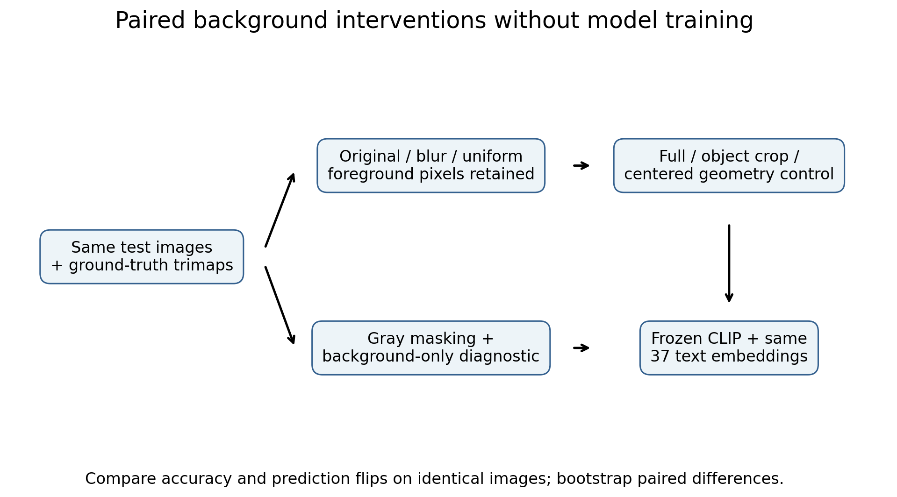
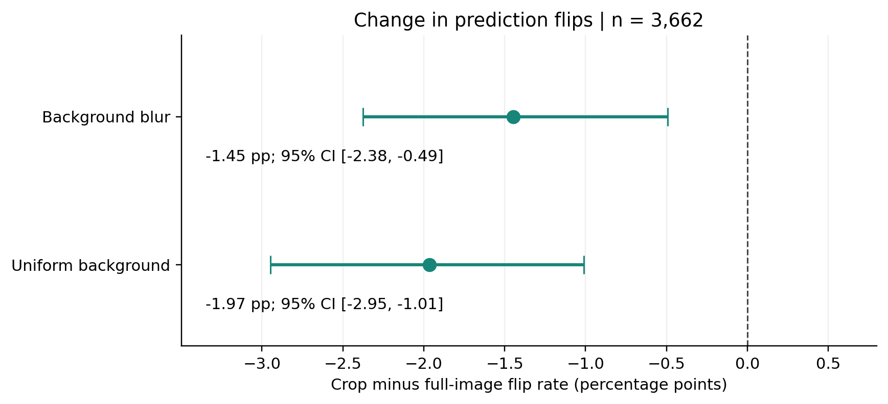
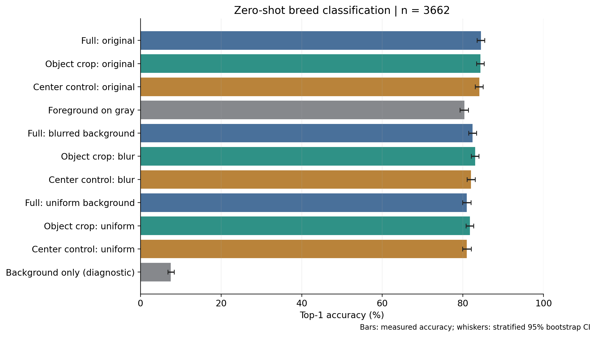
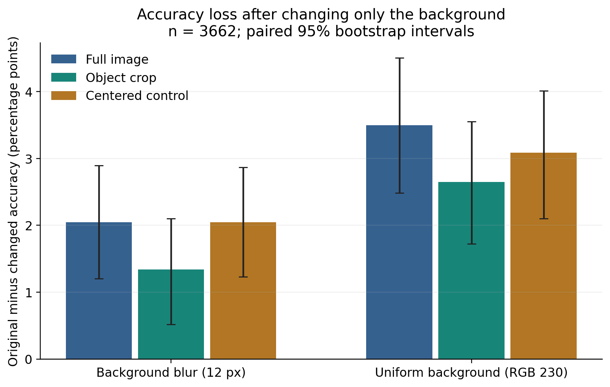
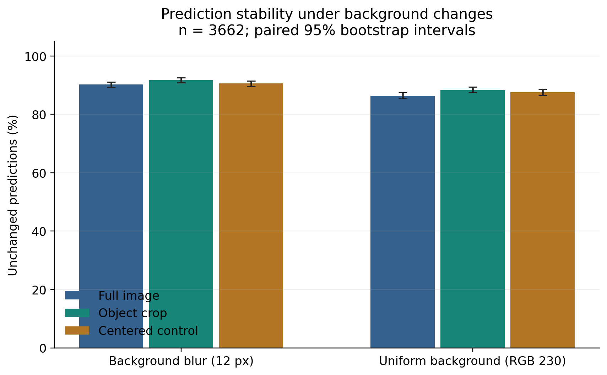

# Can Object-Centric Processing Reduce Background Bias in Vision Models?

A reproducible AIST1000 seminar project using frozen OpenAI CLIP ViT-B/32 and Oxford-IIIT Pet. No model is trained or fine-tuned.

**Main finding:** on 3,662 evaluable test images, object cropping reduced prediction flips by **1.45 percentage points under background blur** and **1.97 points under uniform background replacement**. Both paired 95% bootstrap intervals exclude zero. Classification accuracy gains remain uncertain, and the stability benefit is modest.

## Research question and method

Does focusing on the animal make CLIP's predictions more stable when its background changes?

CLIP compares an image embedding with text embeddings of candidate descriptions ([Radford et al., 2021](https://proceedings.mlr.press/v139/radford21a.html)). All conditions share the same frozen model, ordered list of 37 breeds, and prompt `a photo of a {breed}`. Official class names are lowercased and underscores replaced by spaces.

Ground-truth trimaps define an animal crop or a foreground mask. We change the background while keeping foreground RGB pixels fixed before CLIP preprocessing, then compare full-image and cropped predictions on identical images. Cropping also changes object scale and composition; accuracy changes alone cannot isolate background dependence.



## Dataset and annotation audit

The [Oxford-IIIT Pet dataset](https://www.robots.ox.ac.uk/~vgg/data/pets/) has 37 breeds and pixel-level trimaps. Loading uses `torchvision.datasets.OxfordIIITPet(split="test", target_types=["category", "segmentation"])`.

The official test split contains **3,669 images**. Seven trimaps contain only background pixels, so an animal crop cannot be defined. They are excluded from **every paired condition**, including the full-image baseline. The resulting common cohort contains **3,662 images, 88–100 per breed**, and **40,282 predictions across 11 conditions**. Accuracies are image-weighted.

Exclusions depend on annotation validity, never on model predictions. IDs, reasons, pixel counts and hashes are in [excluded_samples.json](results/main/excluded_samples.json). Original annotations are not modified. Missing or unreadable files still fail explicitly.

Raw trimap labels are **1 foreground, 2 background, 3 uncertain boundary**. The default retains 1 and 3 using hard compositing, without erosion or feathering. Local visual inspection confirmed the mapping but exposed boundary halos and retained nearby background. Normal resize/interpolation can subsequently mix edge colors. Boundary exclusion is configurable but was not evaluated for the main results.

## Experimental conditions

| Condition | Operation before shared CLIP preprocessing |
| --- | --- |
| Full original | Complete RGB image |
| Object crop | Animal bounding box; 10% padding of box width/height on each side, rounded up and clipped |
| Foreground on gray | Replace label-2 background with RGB (128,128,128) |
| Background blur | Gaussian blur, radius 12 source-image pixels, composited into label-2 background |
| Uniform background | Replace label-2 background with RGB (230,230,230) |
| Background only | Replace retained foreground with gray; diagnostic only |
| Centered crop control | Same dimensions as the padded animal box, positioned at the image center |

Full-image, object-crop and centered-crop inference each use original, blur and uniform variants: nine conditions, plus gray masking and background-only inference. Interventions happen **before cropping**, and each image's coordinates stay fixed across its three variants.

The centered control partially matches geometry and resizing, but uses annotation-derived dimensions and may truncate the animal. It does not fully separate object scale, position and context. Blur can spread animal colors into neighboring background even when foreground pixels remain unchanged.

## Installation

Tested full inference: **Python 3.12.9, Windows 11, RTX 5070 Ti Laptop GPU**, PyTorch 2.7.1+cu128, torchvision 0.22.1+cu128, OpenCLIP 3.2.0. Python 3.11 is compatible with the direct package pins but was not tested here. Linux CPU unit tests also passed on the initial release.

From the repository root:

```powershell
python -m venv .venv
.\.venv\Scripts\Activate.ps1
python -m pip install torch==2.7.1 torchvision==0.22.1 --index-url https://download.pytorch.org/whl/cu128
python -m pip install -r requirements.txt
```

If PowerShell activation is disabled, use `.\.venv\Scripts\python.exe` instead of `python`; no execution-policy change is required. On macOS/Linux activate with `source .venv/bin/activate`.

For CPU-only Windows/Linux, install the two PyTorch packages from `https://download.pytorch.org/whl/cpu` first. On macOS use the default PyPI index. See [official PyTorch commands](https://pytorch.org/get-started/previous-versions/).

`requirements.txt` pins direct dependencies. `requirements-lock-windows-cu128.txt` records the complete executed Windows environment; install it with `python -m pip install -r requirements-lock-windows-cu128.txt --extra-index-url https://download.pytorch.org/whl/cu128` for that platform-specific environment.

## Run the experiment

Unit tests require neither dataset downloads nor pretrained weights:

```text
python -m pytest -q
python -m pip check
```

Smoke test: five images and 55 predictions, for execution checking only:

```text
python scripts/run_experiment.py --download --samples 5 --bootstrap 200 --output-dir local_outputs/smoke
```

**Main command:** the default now requests the complete test split and audits invalid trimaps:

```text
python scripts/run_experiment.py --download --output-dir local_outputs/reproduction
```

Equivalent explicit settings:

```text
python scripts/run_experiment.py --download --samples 3669 --seed 42 --batch-size 32 --device auto --exclude-invalid-masks --output-dir local_outputs/full-test
```

Choose an empty output directory for each run. Published results already occupy `results/main`; nonempty destinations are refused. `--download` downloads/extracts missing data only. Initial setup needs network access and several GB of disk space. Model weights and reusable text embeddings are cached under `.cache`.

Defaults are in [configs/default.yaml](configs/default.yaml). CLI overrides include device, sample count, seed, batch size, paths, bootstrap count and boundary policy. `--no-exclude-invalid-masks` restores strict failure on invalid masks. Sample counts below the full split use deterministic, approximately balanced round-robin selection; all 37 candidate labels are retained. Cohorts with invalid masks are filtered after selection without replacement, so actual counts may be smaller than requested. Paths resolve from the repository root.

`--device auto` selects CUDA when available and otherwise CPU. CPU inference was smoke-tested; unavailable explicitly requested CUDA devices fail clearly. The model uses `eval()`, frozen parameters and `torch.inference_mode()`. Float32 normalized embeddings are compared by cosine-similarity argmax. CUDA determinism is enabled and TF32 disabled. The official OpenAI TorchScript checkpoint is SHA256 verified and loaded with the compatible PyTorch setting.

## Measured results

Main evaluation: **1 November 2026; n=3,662 per condition**. Model, prompt, padding, boundary handling and background settings were fixed before expanding the earlier subset to the full test split.

| Processing | Original accuracy | Blur accuracy | Uniform accuracy | Blur flip rate ↓ | Uniform flip rate ↓ |
| --- | ---: | ---: | ---: | ---: | ---: |
| Full image | 84.46% | 82.41% | 80.97% | 9.75% | 13.60% |
| Object crop | 84.35% | 83.01% | 81.70% | 8.30% | 11.63% |
| Centered control | 84.05% | 82.00% | 80.97% | 9.42% | 12.45% |

Foreground-on-gray accuracy: **80.34%**. Background-only accuracy: **7.54%**. The latter is a diagnostic: gray silhouettes, residual pixels and compositing artifacts can retain breed information, so it does not establish natural-background-only reasoning.

| Crop minus full-image comparison | Difference (pp) | Paired 95% CI (pp) |
| --- | ---: | ---: |
| Original accuracy | −0.11 | [−0.82, +0.60] |
| Blur accuracy | +0.60 | [−0.19, +1.42] |
| Uniform accuracy | +0.74 | [−0.08, +1.56] |
| Blur flip rate | **−1.45** | **[−2.38, −0.49]** |
| Uniform flip rate | **−1.97** | **[−2.95, −1.01]** |

The primary flip-rate intervals exclude zero. Accuracy differences still include zero. This supports a **modest stability benefit under these interventions**, without a clear accuracy improvement. Centered cropping also improves some outcomes; accurate localization cannot be credited with the entire effect. See [detailed results and interpretation](docs/results.md).






## Metrics and statistical interpretation

- **Top-1 accuracy:** correct predictions divided by evaluated images.
- **Accuracy drop:** original minus modified accuracy within the same processing method; positive means degradation.
- **Consistency:** proportion of unchanged predictions after an intervention, including unchanged incorrect answers.
- **Flip rate:** one minus consistency; a flip may improve or harm correctness.
- **Paired differences:** calculate method differences per image before averaging.

Intervals use **5,000 class-stratified paired percentile bootstrap resamples, seed 42**. Resample images within each breed, retaining class counts. These intervals describe image-sampling uncertainty conditional on the model, classes, masks and interventions, not variation across models or datasets. Comparisons are exploratory and not adjusted for multiplicity. Percentage differences are **percentage points (pp)**, not relative percent changes. An interval containing zero does not demonstrate equivalence.

With one image per sampled breed, smoke-test intervals degenerate and have no inferential value. Cosine similarities in the prediction CSV are ranking scores, not calibrated confidence probabilities.

## Reproduce the analysis without CLIP

```text
python scripts/verify_results.py --results results/main
python scripts/plot_results.py --results results/main
python scripts/analyze_results.py --results results/main
```

The audit checks paired IDs, exclusions, label mapping, numerical outputs and deterministic bootstrap regeneration. Plotting reads measured CSVs. Supplementary analysis recreates direct paired accuracy comparisons, crop-versus-center comparisons, per-breed accuracies and the flip-rate effect-size figure.

## Repository guide

- `src/`: dataset audit/sampling, preprocessing, frozen model inference, paired metrics and visualization.
- `scripts/`: experiment runner, result audit, plotting and supplementary analysis.
- `tests/`: 30 tests, including invalid-mask exclusion and missing-file handling.
- `results/main/`: the sole published result set—40,282 predictions, estimates, intervals, exclusions, sample hashes, provenance and five chart/schematic figures.
- [Detailed results](docs/results.md), [research brief](docs/research_brief.md), [four-slide speaking outline](docs/presentation_outline.md), [Q&A](docs/qa_preparation.md), [validation record](docs/validation.md).

The earlier 370-image release is available through Git history. It is nested in the full cohort, so the expanded evaluation is not an independent replication. All 4,070 overlapping predictions match exactly.

Photographic grids are written only to ignored `local_outputs/<run-name>/example_visualizations.png`. Dataset images/annotations, weights, environments, caches and credentials are excluded from Git. MIT licensing applies to project code and documentation; third-party assets retain their licenses.

## Limitations and next experiments

1. **Oracle localization:** dataset segmentation is provided; errors from a deployed detector or segmenter are untested.
2. **Artifacts and distribution shift:** boundary halos, hard edges, blur contamination and gray silhouettes complicate interpretation.
3. **Geometry:** crops change scale, position and retained context. The centered control is incomplete.
4. **Coverage:** two artificial interventions, one fixed blur radius/color, one model and one prompt. Natural backgrounds and other domains remain untested.
5. **Statistics and data:** annotation exclusions limit the cohort; near-duplicate images may violate independence. Pretraining overlap is unknown, and bootstrap intervals are conditional.

Next, use natural background swaps with explicit object-size controls, boundary-policy ablations, predicted masks and another frozen model. Check whether the modest paired stability benefit survives those conditions.

## References

1. Radford et al. (2021). [Learning Transferable Visual Models From Natural Language Supervision](https://proceedings.mlr.press/v139/radford21a.html). ICML.
2. Parkhi et al. (2012). [Cats and Dogs](https://www.robots.ox.ac.uk/~vgg/publications/2012/parkhi12a/). CVPR. [Dataset](https://www.robots.ox.ac.uk/~vgg/data/pets/).
3. [Official OpenCLIP implementation](https://github.com/mlfoundations/open_clip), tested version 3.2.0.
4. [torchvision OxfordIIITPet documentation](https://docs.pytorch.org/vision/stable/generated/torchvision.datasets.OxfordIIITPet.html) and [tested-version source](https://github.com/pytorch/vision/blob/v0.22.1/torchvision/datasets/oxford_iiit_pet.py).
